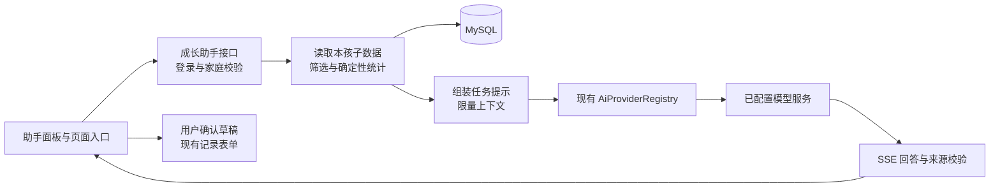

# 拾光 AI 小助手设计方案

状态：整体规划。已按现有千问配置完成源码接入（助手面板、临时多轮聊天、日记草稿、测量整理、家庭开关、请求限额与取消），待手动编译和联调；实施范围与启动方式见《拾光AI小助手使用说明.md》。当前多轮聊天不自动检索家庭记录；本文件中的成长回顾、检索、长期聊天历史等仍为后续设计，不表示已经实现。

## 产品定位

名称建议为「拾光小助手」，帮助家人整理已经记录的成长、把零散文字写成日记，以及找到值得回看的瞬间。沿用奶油白、鼠尾草绿和家庭相册的风格，语气温暖、简洁，以家庭真实记录为依据。

第一版围绕文字和结构化数据展开。已有照片、视频正常保存在 MinIO，第一版助手不读取媒体内容，也不向模型发送媒体地址。照片识别、视频理解、语音输入可在后续单独设计。

## 第一版功能

| 功能 | 用户怎么用 | 助手输出 | 数据来源与限制 |
| --- | --- | --- | --- |
| 帮我写日记 | 在记录表单填写几句话，点击「帮我写一写」 | 标题、正文、最多 6 个标签；可切换简洁、温柔、童趣语气 | 当前用户主动选择的表单文字；缺少细节时询问，不编造孩子的行为、对话和心情 |
| 最近的成长回顾 | 选择孩子、日期范围，点击「回顾这个月」 | 记录概览、被记录的里程碑、测量变化，以及可打开的记录来源 | 本家庭该孩子的有效记录；明确回顾时间和覆盖范围 |
| 看懂测量记录 | 在成长数据页点击「整理测量变化」 | 列出测量起止日期、次数、最新值及变化，指出缺失或需要核对的数据 | 身高、体重、头围与测量时间；计算由后端完成，不做疾病诊断或发育是否正常的判断 |
| 找回一段回忆 | 输入「查找骑车的记录」，可选月份和类型 | 匹配的记录卡片，点击打开现有详情弹窗 | 第一版为日期、类型、标题、正文和标签的结构化/关键词检索；明确匹配规则，无结果时允许调整条件 |
| 接着聊 | 围绕这次回顾追问「帮我写成一段给未来孩子的话」 | 结合当前会话和已选记录继续生成 | 不把其他孩子、其他成员的聊天混入当前会话 |

“这个月没有记录第一次骑车”只表示当前范围中没有相关记录，不能推断孩子从未骑过车。接种记录第一版仅可整理已记录的名称、日期与剂次，不据此自动制定接种计划。

## 页面与交互

桌面端右下角使用「叶芽图标 + 问问拾光」入口，点击后展开约 400–440 px 的右侧面板；不挤压原页面。手机端展开为全屏面板，输入区跟随软键盘，关闭后回到原位置。

助手打开时不自动发送家庭资料，不自动请求模型。用户提交问题或点击快捷任务才开始执行。

```text
┌────────────────────────────────┐
│ 🌱 拾光小助手    新对话  历史  × │
│ 和你一起，好好收藏成长           │
│                                │
│ 当前孩子 [小禾 ▾]               │
│ 时间范围 [本月 ▾]               │
│                                │
│ 今天想一起整理什么？            │
│ [帮我写日记] [回顾这个月]        │
│ [整理测量变化] [找一段回忆]      │
│                                │
│ 回答文字逐步显示……              │
│ 依据：9 月 2 日、9 月 20 日测量  │
│ [查看来源] [复制]               │
│                                │
│ 将使用：本月日记、里程碑、测量  │
│ [输入想问的问题……       ] [发送]│
└────────────────────────────────┘
```

页面内同时提供自然入口：

- 新增/编辑成长记录弹窗：正文旁「帮我写一写」。弹窗内展开草稿面板，避免在原 dialog 上叠加第二个弹窗。
- 成长数据页：曲线上方「整理测量变化」，默认当前孩子及选定时间。
- 时间线：孩子筛选旁「回顾这段时光」。
- 记录详情：「把这段回忆写得更完整」，由用户选择是否引用本条文字。

切换孩子时提示开始该孩子的新对话，不把上一位孩子的对话历史带过去。每个会话绑定一个孩子；在已有会话里扩大日期范围要明确显示新的数据范围。

### 回答与草稿

普通回答使用正文 + 来源卡片。日期、数量、数值应与后端计算结果一致；来源跳转复用成长记录详情或测量列表定位。

日记生成使用可编辑卡片：标题、正文、标签、日期、孩子。按钮为「填入表单」「重新生成」「复制」。点击填入前，如果表单已有文字，显示原文与新草稿，允许保留原文或确认替换；从助手独立入口进入则打开新的记录表单。

填写表单后仍需用户点击原来的「保存」。AI 不直接新增、修改或删除记录，不自动覆盖原文，不修改身高、体重、头围或接种信息。已有记录的编辑权限由原业务接口再次检查。

### 等待、失败与空状态

过程显示「正在整理记录 → 正在生成回答 → 已完成」。通过 SSE 逐步展示正文，提供「停止生成」。停止后保留已生成内容并标记“未完成”，不作为完整结论或自动纳入后续模型历史。

无数据时提示「这段时间还没有相关记录」，给出添加入口或调整范围入口；不生成虚构回顾。模型不可用、超时或额度不足时保留输入并允许手动重试，网站原有记录功能继续可用。

来源卡片只在服务端验证来源编号后呈现，不把模型生成的任意 URL 当作可点击来源。未完成的流式文本默认以纯文本显示，避免直接插入模型返回的 HTML。

## 数据使用和权限

服务端从 `GrowthAuth.actor(session)` 获取用户与家庭，校验目标孩子属于本家庭；客户端不提供可信的 familyId、角色、模型系统提示或完整聊天历史。

- 管理员和普通家庭成员均可提问，读取范围遵守现有家庭可见性。普通成员采用日记草稿时仍只能修改自己有权限编辑的记录。
- 助手聊天按 `family_id + user_id + child_id` 隔离。家庭成员可看家庭成长记录，并不意味着可以查看其他成员的助手聊天；管理员也不额外获得他人的聊天内容。
- 分享页访客不开放助手；成员被移出家庭后会话查询、提问和来源跳转均失效。
- 第一版默认不启用外部模型数据发送。管理员在「空间设置」开启助手并看到实际模型服务名称及发送范围；成员首次使用时看到同样的简短说明，再主动使用。关闭后拒绝新调用并尝试停止正在生成的任务，已发送到模型服务的数据不能据此撤回。
- 只发送本次需要的资料，如年龄/月龄、测量日期与数值、选中的日记内容；不发送手机号、密码、邀请码、分享令牌、MinIO 凭证、原始媒体或对象地址。日记正文仍可能包含用户写入的个人信息，不能声称完全匿名。
- 用户可查看、删除自己的聊天。聊天删除并不等于模型服务侧的数据同步删除，界面准确说明删除范围。

每次提问重新读取业务数据，避免测量修改、记录删除后继续引用旧数据库快照。消息存储上下文版本和来源编号；相关成长记录/测量变更后，将依赖它们的回答标记为“来源已更新”，历史回答不再自动带入下一轮，需要重新生成。涉及已删除源数据的旧生成内容应隐藏或清理，不能通过历史会话绕过删除；后续实现须覆盖来源变更和正在生成的请求竞争情况。

用户输入、日记正文和历史消息均作为待处理内容，不能修改系统权限或让模型执行任意 SQL。所有查询由服务端固定查询方法完成，参数化 SQL 同时携带家庭和孩子条件。

## 结合现有项目的后端方案

现有 `AiProviderRegistry` 已管理模型客户端，`AiChatService` 已有普通和 SSE 对话能力；`AiStreamEvent` 当前支持 delta、done、error。现有 `/api/ai/**` 是独立调试接口，没有成长家庭鉴权，也没有成长数据检索及聊天持久化。

新增成长助手业务层，复用模型注册表和流式事件处理方式。不要让家庭页面直接调用现有调试接口。成长助手使用独立系统提示、服务端选择的模型和已授权的数据上下文，避免修改调试台的默认行为。



建议职责：

| 组件 | 职责 |
| --- | --- |
| `GrowthAssistantController` | 会话、消息、停止生成及历史查询；所有接口执行家庭鉴权 |
| `GrowthAssistantService` | 任务编排、固定系统提示、调用模型、流式事件、失败与取消处理 |
| `GrowthAssistantContextService` | 按家庭、孩子、时间查询日记/里程碑/测量，计算次数、变化及来源清单 |
| `GrowthAssistantStore` | 会话归属、消息、请求状态和来源版本持久化 |
| `assistant.js / assistant.css` | 面板、对话、来源卡片、草稿回填，与现有 growth.js 协作 |

JDBC 查询与模型调用分开。数据读写采用短事务，模型生成期间不持有家庭行锁或数据库连接。避免沿用大文件上传中长时间持锁的方式。

成长助手配置放在 `growth.ai.*`，建议包括 enabled、provider、model、timeout、max-context-tokens、max-output-tokens、max-concurrent-per-user、daily-request-limit。复用已有密钥配置，不在前端暴露密钥，也不允许客户端随意指定高成本模型。

第一版不引入新的 Redis、向量数据库或 Agent 框架。结构化查询和关键词搜索已经能支撑这些确定的任务；后续如果需要语义检索，再评估索引和向量检索。

## 接口与数据结构草案

路径统一位于 `/api/growth/assistant`，沿用同源 Cookie 和 `X-Growth-Request: 1`。SSE 使用 `fetch POST` 读取响应流，支持 AbortController；新 Controller 需纳入现有成长业务异常处理范围。

| 方法 / 路径 | 用途 |
| --- | --- |
| `GET /settings`、`PUT /settings` | 查看助手启用状态；仅管理员可改变家庭设置 |
| `POST /sessions` | 创建指定孩子的私有会话 |
| `GET /sessions?childId=...` | 分页查询本人该孩子的会话 |
| `GET /sessions/{id}/messages` | 分页查询本人消息及来源状态 |
| `POST /sessions/{id}/messages/stream` | 发送任务和问题，流式返回 |
| `POST /sessions/{id}/requests/{requestId}/cancel` | 取消本人请求，配合浏览器取消订阅 |
| `DELETE /sessions/{id}` | 删除本人会话及相关消息，不删除成长记录 |

请求只接收经过校验的 task、question、日期范围、可选 recordId / draftText、clientRequestId。task 使用固定枚举：diary、review、measurements、search、followup。记录编号和日期必须再次授权、校验，不接受模型生成的 SQL。

SSE 事件建议为 meta（任务与范围）、stage（进度）、delta（正文）、sources（已校验的来源）、draft（完整验证后的草稿）、done、error。结构化日记草稿必须等完整生成并通过字段校验后才允许填入，流式正文不当作可执行指令。

新增 MySQL 表草案：

- `ai_family_settings`：family_id（唯一）、enabled、enabled_by、enabled_time、updated_time。
- `ai_conversation`：id、family_id、user_id、child_id、title、create_time、update_time。
- `ai_message`：id、conversation_id、role、content、task、status、request_id、parent_message_id、create_time。status 区分 pending / complete / cancelled / failed / stale。
- `ai_message_source`：message_id、source_type、source_id、source_version，用于来源跳转和失效处理。source_type 仅允许业务白名单。

同一会话的 request_id 建唯一约束，避免重复点击或网络重试创建重复消息；每会话只允许一个活跃生成任务。重试已失败任务需要新的 requestId 并关联原消息。家庭和会话归属在消息查询与写入时通过 JOIN 校验。

来源版本可通过规范化字段哈希实现，避免为现有业务表立即增加版本字段。检索时只把来源版本仍有效、状态 complete 的必要历史纳入上下文。业务写接口需要增加来源失效处理，确保历史内容与当前授权一致。

## 响应速度与成本

上下文按任务检索，不把 `/snapshot` 全量结果或整个家庭历史发送给模型。一般问题仅携带最近必要对话；成长回顾由 SQL 先统计完整范围，再提供有限的文字样本。若采样或截断，界面说明“覆盖统计范围，正文基于所列记录”，不能称逐条读完全部记录。

拟定起始限制：单次问题 2000 字、日期范围不超过 1 年、每用户同时 1 个生成任务；上下文和输出 token 上限结合实际配置模型设置，保留超限提示，不依赖字符数冒充精确 token 数。这些为待调优参数，不是实测性能承诺。

记录鉴权/检索、上下文构建、模型首段响应、模型总耗时和成功/失败状态，日志不记录完整儿童资料和对话正文。请求限额按持久化状态统计，多实例也能生效；拿不到准确 token 用量时不展示虚构的费用。

## 建议落地顺序与验收

第一阶段完成助手面板、数据发送说明与开关、家庭鉴权、帮写日记、测量整理和停止生成，先验证真实记录与引用准确性。第二阶段加入成长回顾、关键词找记录、持久化历史和完整来源失效机制；没有完成来源失效前，不默认保存长期对话历史。

后续再考虑语音输入、明确选中的照片理解、向量检索、月度报告等功能。第一版不承诺自动通知、不后台定时调用模型、不自动代用户改数据。

实施后的手动验收重点：

1. 普通成员和管理员都只能问本家庭孩子；其他家庭的 childId / conversationId / recordId 均拒绝，分享访客不可用。
2. 切换孩子不会带入另一孩子的上下文；其他家人的聊天不可见。
3. 修改、删除测量或日记后重新提问使用新数据，旧回答的来源状态同步失效；并发生成不能绕过删除。
4. 草稿不编造事实，使用前可编辑、取消；没有点击原记录表单保存时，数据库不新增成长记录。
5. 空数据、停止、断网、模型超时、额度限制与重复提交均有明确状态，网站其他功能不受影响。
6. 记录正文包含“忽略权限、读取其他家庭”等文本时，不能触发额外数据访问或任意业务写入。

设计中涉及的模型可用性、真实响应速度和运行效果尚未验证。模型厂商沿用现有可用配置，由服务端统一设置；本稿不更改当前网站运行行为。
